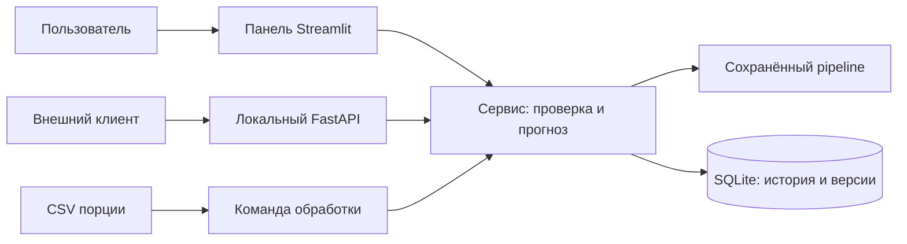
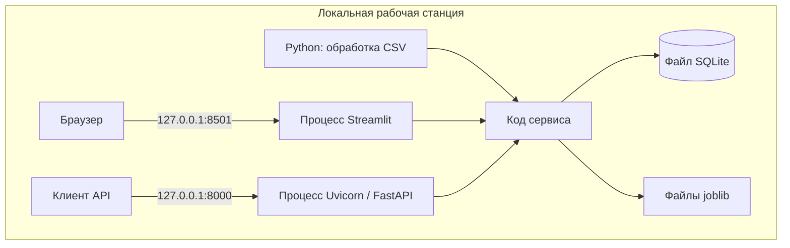

# Система прогнозирования и мониторинга

## Архитектура

| Логический компонент | Физическая реализация |
| --- | --- |
| Ввод и визуализация | `new/app/dashboard.py`, Streamlit |
| Интеграционный интерфейс | `new/src1/api.py`, FastAPI |
| Загрузка порции | `new/src1/process_batch.py`, `new/src1/service.py` |
| Проверка, прогноз, мониторинг | `new/src1/service.py` и сохранённые sklearn pipeline |
| История и реестр | локальная SQLite `new/runtime/monitoring.sqlite3` |
| Модели | `models/*_model.joblib`, кандидаты в `new/runtime/models/` |

Физическое размещение: на одной рабочей станции запускаются процесс панели и, отдельно, процесс API. Оба обращаются к файлам моделей и одной локальной SQLite. По умолчанию сетевой доступ ограничен `127.0.0.1`. Архитектура не предусматривает авторизацию и не предназначена для публикации в сети.

## Правила мониторинга

| Уровень | Показатель | Частота | Порог | Реакция |
| --- | --- | --- | --- | --- |
| Данные | Ошибка схемы, диапазона или категории | При приёме | Любое нарушение | Неверные строки изолируются; при ошибке схемы отклоняется порция |
| Данные | PSI: age, absences, failures | После порции | Более 0,25 | Предупреждение, анализ |
| Модель | MAE с известной G3 | После порции | Ранняя > 3,5; поздняя > 2,0 | Предупреждение, анализ |
| Работа системы | Время обработки и ответа API | При обработке и запросе | Порог не установлен | Сохранение или вывод измерения |

Численные пороги являются учебными ориентирами, а не гарантиями пригодности. Случайные порции по 39–40 строк не представляют независимый поток во времени. PSI зависит от размера выборки; известные ограничения моделей сохраняются.

### Правило реакции и переобучения

После каждой успешно проверенной порции вычисляются PSI и, если известна G3, MAE. Значение PSI более 0,25 или MAE выше порога соответствующего сценария — сигнал специалисту проверить данные, размер порции и ошибки. Пропуск G3 не считается нарушением порога MAE: качество по нему не оценено. При отсутствии сигнала можно не запускать переобучение.

Если пришла полностью размеченная порция и сработал сигнал PSI или MAE, система автоматически пытается обучить кандидата. Требуются как минимум две размеченные порции без пересечений с исходным test и между обучением и сравнением; иначе причина пропуска фиксируется в журнале. Система обучает кандидата на предыдущих допустимых данных и сравнивает обе модели на последней размеченной порции. Переключение допускается вручную при более низкой MAE кандидата и выполнении порога MAE; фиксируются версия, данные сравнения и метрики. Предыдущая версия остаётся доступной для отката. Автоматически действующая модель не заменяется.

Поскольку порции небольшие, случайные и ранее анализировались, повторное сравнение на них не является независимым подтверждением качества. При появлении действительно новых данных потребуется отдельная независимая проверка до практического применения.

## Обработка и история

При приёме проверяются схема, обязательные значения, типы, допустимые диапазоны и категории. При неверной схеме отклоняется порция, а при неверных значениях отдельные строки исключаются из обработки и записываются в журнал по номеру и причине. Исходные значения отклонённых строк в журнале не сохраняются. Хеш SHA-256 исходного файла предотвращает повторную обработку тех же байтов. Файлы с теми же строками в другом порядке этим правилом не определяются как идентичные; дубли строк показываются отдельно. SQLite хранит исходные обезличенные признаки, прогнозы, результаты проверок, PSI, метрики, версии и события. При отсутствии G3 метрики по ней не вычисляются. База и кандидаты исключены из Git.

## Версии и переобучение

Исходные модели и их метаданные хранятся в `models/`. Кандидат обучается на исходных train + validation и всех размеченных порциях, кроме последней. Последняя размеченная порция используется для сравнения с действующей моделью на одинаковых строках. Проверяется отсутствие пересечений по ранним признакам между обучением и сравнением, а также с исходной test-выборкой. Метаданные содержат номера порций, параметры, MAE и SHA-256 файла кандидата.

Кандидат допускается к ручному переключению, только когда его MAE ниже MAE действующей модели и не превышает порог MAE для порции. После смены действующей модели старое сравнение кандидата теряет силу. Доступен ручной откат к ранее активной версии. Используемые порции уже анализировались, поэтому это демонстрационная, а не независимая оценка.

## Роли и воспроизводимость

Пользователь вводит признаки и просматривает прогноз; аналитик проверяет порции и предупреждения; специалист по ML оценивает кандидата и принимает решение о переключении; разработчик поддерживает код и тесты. В учебном проекте все роли могут выполняться одним человеком. Код версионируется Git, зависимости описаны в `requirements.txt`, исходное разделение и контрольная сумма зафиксированы, случайные состояния моделей заданы ранее. Локальные данные и история в Git не публикуются.

## Проверка и оставшиеся действия

Команды запуска приведены в README. Четыре имеющиеся порции обработаны в локальной базе. Измеренное время обработки составило примерно 0,19–0,20 с на порцию в текущем окружении; это разовое измерение, без учёта всех возможных условий. Для ранней модели MAE порции `batch_02` равна 4,255, что выше ориентира 3,5; для `batch_04` PSI возраста равен 0,280, что выше 0,25.

Во временной отдельной базе проверен кандидат поздней модели: MAE действующей модели на `batch_04` составила 1,009, кандидата — 0,896. Кандидат был обучен на исходных train + validation и порциях 01–03; сравнение выполнено на порции 04. В этой временной базе проверены переключение и возврат исходной версии. В рабочей базе исходные модели остаются активными. Результат не является независимым подтверждением качества: те же порции ранее исследовались.

Время ответа локального API измерено скриптом `python -m scripts.measure_api` через HTTP на `127.0.0.1:8000`: для каждого сценария после одного прогревочного запроса выполнено по 10 последовательных запросов к активной версии `original`. Среднее время: 60,46 мс для раннего и 76,31 мс для позднего сценария; 95-й перцентиль — 63,72 и 79,61 мс соответственно. Данные и прогнозы студентов в таблицу не записываются, сохранена только сводка `reports/tables/monitoring/api_latency.csv`. Это результат одного замера в текущем окружении, а не гарантия быстродействия при другой нагрузке.

Автоматические проверки запускаются командой `python -m unittest discover -s new/tests -v`: последний полный запуск — 49 тестов, успешно. Проверено, что непредвиденная ошибка обучения кандидата не отменяет уже обработанную порцию: тип ошибки фиксируется в журнале без подробностей исключения. `scripts.verify_monitoring` в двух изолированных прогонах получил одинаковые контрольные суммы прогнозов, метрик и PSI. Порция из 1000 строк, полученных повторением 40 учебных записей, обработана за 0,178 секунды в текущем окружении; это единичный нагрузочный замер, не тест на новых данных. Таблица — `reports/tables/monitoring/verification.csv`.

`scripts.demonstrate_monitoring` в отдельной временной базе подтвердил автоматическое создание кандидатов после сигналов, сравнение поздней модели (1,009 против 0,896 MAE), переключение и возврат версии `original`. В отдельном повреждённом примере две строки из трёх изолированы и записаны в журнал по номерам 2 и 3. Результат — `reports/tables/monitoring/lifecycle_demo.json`; рабочая база и её активные модели не изменены.

Таблица соответствия исходным требованиям — `reports/tables/architecture/requirements_traceability.csv`; частичные пункты указаны явно. Агрегированные таблицы и графики, восстановленные по сохранённой истории порций, находятся в `reports/tables/monitoring` и `reports/figures/monitoring`. Это графики по истории, а не снимки окна панели. Для полного соответствия требованиям отчёта необходимо приложить снимки панели для каждой порции и оформить отчёт.
